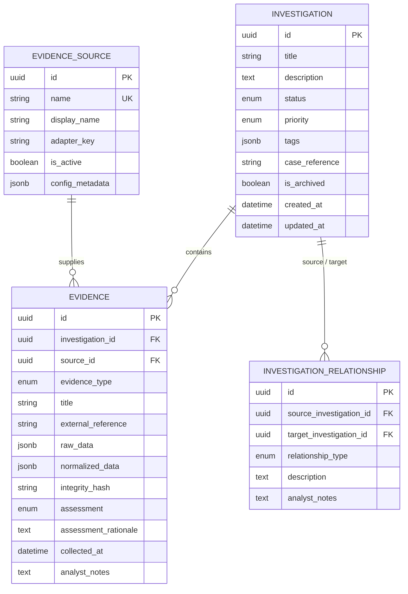
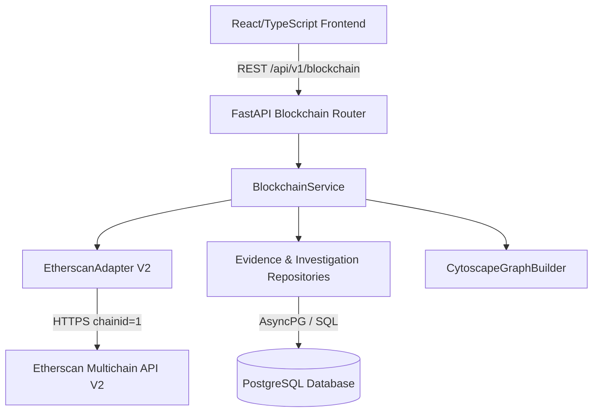

# CryptoTrace AI — Architecture Specification (Phase 1)

## 1. System Philosophy & Design Principles

CryptoTrace AI is engineered as a local-first, modular forensic analysis workstation for blockchain tracing, threat intelligence correlation, and static malware artifact indexing.

### Core Architectural Principles
1. **Local-First & Air-Gapped Capable**: The platform runs on analyst infrastructure without requiring third-party cloud analytics or external centralized databases.
2. **Strict Segregation of Observed Facts vs. Hypotheses**:
   - Facts: Exact raw blockchain transaction receipts, cryptographic hash values, IP records, and timestamps.
   - Hypotheses: Heuristic cluster labels, threat attribution indicators, and analyst notes.
3. **Decoupled Integration Adapters**: External services (Etherscan, VirusTotal, Shodan, LLMs) are accessed exclusively via decoupled interface contracts. Business logic never depends directly on a concrete third-party SDK or vendor API.
4. **Zero-Trust Key Management**: CryptoTrace AI operates in read-only and analytical modes. No automated transaction broadcasting, wallet key collection, or private key storage is allowed in the application architecture.

---

## 2. Monorepo Organization

```
CryptoTrace/
├── backend/
│   ├── alembic/                 # Database schema migrations
│   ├── app/
│   │   ├── api/v1/              # Versioned API routes & dependency injection
│   │   │   └── endpoints/       # Route handlers (health, investigations)
│   │   ├── core/                # Settings, configuration, logging, exceptions
│   │   ├── db/                  # Engine, session management, repository layer
│   │   │   └── repositories/    # Query isolation & transactions
│   │   ├── models/              # SQLAlchemy 2.0 async ORM models
│   │   ├── schemas/             # Pydantic v2 validation contracts
│   │   ├── services/            # Business logic decoupled from transport & ORM
│   │   └── main.py              # FastAPI app factory, CORS & lifespan hooks
│   ├── tests/
│   │   ├── unit/                # Schema validation & service unit tests
│   │   └── integration/         # HTTPX route & DB repository integration tests
│   ├── pyproject.toml           # Python packaging & dependencies
│   └── alembic.ini              # Migration runner configuration
├── frontend/
│   ├── src/
│   │   ├── app/                 # Application root & router wiring
│   │   ├── components/          # Reusable UI library & layout components
│   │   │   ├── layout/          # TopNav, Sidebar, AppLayout
│   │   │   ├── ui/              # Badges, Buttons, Cards, Inputs, Dialogs
│   │   │   └── investigations/  # Table grids, status pills, filter bars
│   │   ├── hooks/               # TanStack Query & Theme state management
│   │   ├── lib/                 # Utility functions & formatting
│   │   ├── pages/               # Dashboard, Investigations, Detail, Explorer, Settings
│   │   ├── services/            # Axios API client & typed endpoints
│   │   └── types/               # TypeScript domain contracts
│   ├── tests/                   # Vitest & Testing Library test suites
│   ├── package.json             # NPM package manifests & scripts
│   ├── vite.config.ts           # Vite + proxy + vitest configuration
│   └── tailwind.config.js       # Cyber-intelligence color palette & typography
├── docs/
│   ├── architecture.md          # System architecture & data flow
│   ├── api.md                   # OpenAPI & REST API contract
│   └── security.md              # Security model & threat boundary
├── docker-compose.yml           # Local multi-container development environment
├── .env.example                 # Environment configuration template
└── README.md                    # Developer onboarding & operations guide
```

---

## 3. Data Integrity & Domain Model

The database layer utilizes PostgreSQL with SQLAlchemy 2.x async ORM and UUID primary keys.



### Assessment Rationales
Arbitrary percentage confidence scores (e.g. "98% malicious") are avoided because they obscure investigative justification. CryptoTrace uses qualitative assessment statuses accompanied by mandatory rationales:
- `UNVERIFIED`: Collected, awaiting forensic confirmation.
- `PROVIDER_SUPPLIED`: Sourced from external vendor, uncorroborated.
- `CORROBORATED`: Supported by two or more independent signals.
- `CONTRADICTED`: Conflicting reports identified.
- `ANALYST_CONFIRMED`: Verified through manual analyst audit.
- `ANALYST_REJECTED`: Falsified or dismissed.

---

## 4. Phase 2: Blockchain Forensics Architecture

### Component Hierarchy


### Key Forensic Safeguards
1. **Zero Binary Floating-Point Arithmetic**:
   All cryptocurrency denominations (Wei, Gwei, Ether) and ERC-20 token quantities are parsed and evaluated using exact Python `Decimal` instances or retained as raw integer strings.
2. **EIP-55 Checksum Validation Without Native C-Extensions**:
   Implemented via a self-contained, pure-Python Keccak-256 sponge permutation algorithm. Enforces EIP-55 checksumming on mixed-case Ethereum addresses, while accepting valid all-lowercase or all-uppercase addresses and normalizing them to canonical checksum format.
3. **Evidence Idempotency & Conflict Strategy**:
   Backed by a partial unique index on PostgreSQL:
   ```sql
   CREATE UNIQUE INDEX uq_evidence_investigation_type_ref
   ON evidence (investigation_id, evidence_type, external_reference)
   WHERE external_reference IS NOT NULL;
   ```
   If a transaction or token transfer has already been ingested into a case, the existing raw evidence is preserved intact without mutation or overwriting.
4. **Deterministic Integrity Hashing**:
   Before persistence, ingested payloads are transformed into deterministic canonical JSON (sorted keys, compact delimiters) and hashed via SHA-256. This hash detects storage tampering or database corruption; it is clearly documented as not proving upstream provider veracity.
5. **Bounded Graph Construction**:
   To prevent denial-of-service or memory exhaustion from high-volume accounts, graph expansion is strictly constrained by a hard `max_nodes` ceiling (default 50), bounded crawl depth (1 hop), and per-hop request budgets. Edges represent observed transactions, never speculative ownership inferences.
